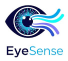

# EyeSense: High-Efficiency, Low-Fatigue Predictive Augmentative Communication

 

> ℹ️ EyeSense is currently a private project. This repository is a public overview; the application source code is not included.

## Project overview

**EyeSense** is an applied research project that develops a **Predictive Augmentative Communication
(PAC)** system based on Artificial Intelligence and Augmented Reality. Its goal is to reduce eye
fatigue and increase communication speed for people who rely on **eye tracking**, both in
educational settings and in everyday life.

The system combines conversational context analysis, advanced text prediction and personalised
speech synthesis to deliver communication that is both efficient and true to the user's identity.

## Castilla y León Research and Innovation Award

EyeSense, a project from IES Alonso de Madrigal (Ávila, Spain), won the award for the best
Vocational Training research project at the **Castilla y León Research and Innovation Awards
2025-2026**. The award was announced in May 2026, the second year in a row that the school has won
one of the region's main awards.

Press coverage (in Spanish):
[Cadena SER](https://cadenaser.com/castillayleon/2026/05/08/un-proyecto-del-ies-alonso-de-madrigal-gana-el-premio-de-investigacion-e-innovacion-de-castilla-y-leon-ser-avila/) ·
[Diario de Ávila](https://www.diariodeavila.es/noticia/z816c67a9-f2b2-4114-90b978d4fc24c639/202605/eyesense-mejor-proyecto-de-investigacion-de-fp-en-cyl)

**[EyeSense website](https://eyesense.es)** 

---

## Key features

EyeSense is designed as a **multimodal system** that approaches communication from several angles:

1. **Integrated eye tracking:** modified Augmented Reality hardware with low-cost cameras captures
   gaze accurately, including **fixations and dwell time**.
2. **Contextual prediction model (AI):**
   - A Natural Language Processing (NLP) model predicts complete sentences in real time.
   - Predictions are refined using the **conversation context** (sentence history) and the user's
     **emotional state** (detecting frustration, anger, etc.).
3. **Emotion detection:** data from external BLE sensors (such as EDA/HRV) provides emotional
   **arousal** and **valence** as input features for the AI, so predictions take the user's
   emotional state into account.
4. **Adapted keyboard:** an **Android** user interface optimised for gaze interaction, which shows
   the predicted sentences to minimise eye effort.
5. **Personalised speech synthesis:** AI voice cloning recreates the user's own voice, so the audio
   output keeps their identity and emotional tone.

---

## One of my contributions: keyboard design and development

I designed the hexagonal EyeSense keyboard and built
[**Letter Metter**](https://github.com/polrubiano/letter-metter), an open-source tool that measures its
efficiency against QWERTY.

On the full text of *Don Quijote*, the EyeSense layout needs **53 % less eye travel** than QWERTY
(theoretical model, see the [limitations](https://github.com/polrubiano/letter-metter#limitations)).
